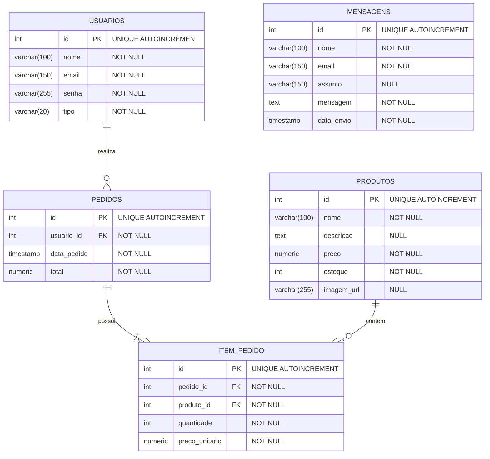

## Lumina & Graça — E-Commerce de Moda Cristã e Vestuário Modesto

A **Lumina & Graça** é uma aplicação web desenvolvida em PHP com foco no gerenciamento e na comercialização de peças de moda modesta e vestuário cristão. O sistema foi criado com o objetivo de oferecer uma experiência de compra elegante, organizada e fluida para as clientes, além de proporcionar uma interface simples e eficiente para a gestão da loja por parte dos administradores.

A plataforma permite realizar operações essenciais de e-commerce e administração, como cadastro, listagem, edição e exclusão de registros de produtos (CRUD), controle de estoque em tempo real, acompanhamento de pedidos e centralização de mensagens de atendimento, utilizando um banco de dados PostgreSQL integrado. Dessa forma, o sistema auxilia no controle das informações do catálogo, dos usuários e das vendas, tornando o atendimento mais rápido, seguro e alinhado aos valores da marca.

---

## 1. Como Executar o Projeto

Para rodar este projeto na sua máquina, será necessário ter instalado um ambiente de servidor local (**PHP**) e o banco de dados **PostgreSQL**.
## Pré-requisitos

- PHP instalado e configurado;
- PostgreSQL instalado e em execução;
- Navegador web.

### Passo a Passo

#### Passo 01. Baixar o projeto em sua máquina

- Copie a URL desse repositório
```bash
https://github.com/VitoriaPorto14/lumina_graca.git
```
- Abra o Terminal, Prompt de Comando ou Git Bash no seu computador e navegue até a pasta onde deseja salvar o projeto:
```bash
cd caminho/pasta_desejada
```

- Execute o git clone:
```bash
git clone <https://github.com/VitoriaPorto14/lumina_graca.git>
```

- Acesse a pasta:
```bash
cd lumina_graca
```

#### Passo 2: Configurar o Banco de Dados
Juntamente aos arquivos do projeto, você tem acesso ao dump do banco de dados `lumina.sql`, você usará ele neste momento. Siga as instruções abaixo:

- Abra o Terminal, Prompt de Comando ou PowerShell.
- Conecte-se ao PostgreSQL de acordo com seu sistema operacional:

    - Linux/macOS (Terminal):
    ```bash
    sudo -u postgres psql
    ```

    - Windows (Prompt/PowerShell):
    ```bash
    psql -U postgres
    ```

- Crie o banco de dados `lumina`:
```sql
DROP DATABASE IF EXISTS lumina;
CREATE DATABASE lumina;
```

- Crie o usuário lumina com senha:
```bash
CREATE USER lumina WITH PASSWORD 'lumina123';
```

- Altere proprietário do database:
```bash
ALTER DATABASE lumina OWNER TO lumina;
```

- Verifique se tudo ocorreu bem (banco de dados e usuário criados)
    - Verificação do banco de dados:
```bash
\l
```
- Saia do usuário postgres:
```bash
\q
```
- Entre, seguindo o caminho abaixo:
```bash
cd /var/www/html/lumina_graca/
```

- Estando na raiz do projeto `(pasta lumina_graca)`, restaure o banco de dados executando o seguinte comando:
```bash
psql -U lumina -d lumina -f lumina.sql
```

## 2. Regras de Negócio (RN)

| Categoria | Código | Regra de Negócio | Descrição |
| :--- | :---: | :--- | :--- |
| **Autenticação** | `RN01` | Níveis de Acesso | O sistema possui apenas dois perfis de usuário: `cliente` e `admin`. |
| **Autenticação** | `RN02` | Restrição do Admin | Páginas de gestão (`estoque.php`, `pedidos.php`, `mensagens.php`) são exclusivas do perfil `admin`. |
| **Autenticação** | `RN03` | Login para Compras | É obrigatório estar logado para acessar o checkout e finalizar um pedido. |
| **Autenticação** | `RN04` | Unicidade de E-mail | Não é permitido cadastrar mais de uma conta utilizando o mesmo e-mail. |
| **Estoque** | `RN05` | Gestão do Catálogo | Apenas o perfil `admin` pode adicionar, editar, atualizar ou remover produtos. |
| **Estoque** | `RN06` | Imagem do Produto | Todo produto deve ter uma imagem em `uploads/` ou exibir uma imagem padrão (*placeholder*). |
| **Estoque** | `RN07` | Baixa de Estoque | A cada pedido finalizado, o sistema decrementa automaticamente 1 unidade do estoque no banco. |
| **Estoque** | `RN08` | Estoque Indisponível | Produtos com estoque zerado (0) não podem ter pedidos concluídos pelos clientes. |
| **Pedidos** | `RN09` | Vínculo do Pedido | Todo pedido gravado deve obrigatoriamente estar associado ao ID do cliente logado. |
| **Pedidos** | `RN10` | Endereço Obrigatório | O formulário de checkout exige o preenchimento de CEP, rua, número, bairro, cidade e estado. |
| **Pedidos** | `RN11` | Integração WhatsApp | Ao concluir a compra, o sistema salva o pedido e direciona o cliente para o WhatsApp com o resumo. |
| **Vitrine** | `RN12` | Destaques da Home | A seção "Mais Vendidos" na página inicial exibe apenas produtos pré-selecionados por ID. |
| **Vitrine** | `RN13` | Listagem de Produtos | A vitrine (`m_produtos.php`) deve listar todos os produtos ativos do banco de dados. |
| **Atendimento** | `RN14` | Envio Assíncrono | O formulário "Fale Conosco" envia dados e salva na tabela `mensagens`. |
| **Atendimento** | `RN15` | Leitura de Mensagens | Somente o usuário `admin` tem acesso à central de mensagens enviadas pelos clientes. |

## 3. Requisitos Funcionais (RF)

Os requisitos funcionais descrevem as ações e comportamentos específicos que o sistema deve realizar para atender às necessidades dos utilizadores e administradores.

| Código | Nome | Descrição |
| :---: | :--- | :--- |
| **RF01** | **Registo de Utilizadores** | O sistema deve permitir que novos clientes se cadastrem informando nome, e-mail e palavra-passe. |
| **RF02** | **Autenticação (Login/Logout)** | O sistema deve permitir que clientes e administradores iniciem e terminem sessão com e-mail e palavra-passe. |
| **RF03** | **Gestão do Perfil** | O cliente deve poder atualizar os seus dados pessoais (nome, e-mail, palavra-passe) e eliminar a sua conta. |
| **RF04** | **Exibição da Vitrine** | O sistema deve listar os produtos do catálogo na página de produtos e destacar os "Mais Vendidos" na página inicial. |
| **RF05** | **Processamento de Checkout** | O sistema deve recolher os dados de entrega (CEP, morada, pagamento) e registar a solicitação do pedido. |
| **RF06** | **Integração com WhatsApp** | O sistema deve gerar uma mensagem pré-formatada com o resumo do pedido e redirecionar o cliente para a API do WhatsApp. |
| **RF07** | **Envio de Mensagens de Contato** | O sistema deve disponibilizar um formulário "Fale Conosco" para envio de dúvidas e mensagens de suporte. |
| **RF08** | **Gestão de Produtos (CRUD)** | O administrador deve poder cadastrar, visualizar, editar e remover produtos do catálogo, incluindo o upload de imagens. |
| **RF09** | **Gestão de Pedidos** | O administrador deve visualizar a lista completa de pedidos realizados, com dados do cliente, data e valor total. |
| **RF10** | **Leitura de Mensagens** | O administrador deve ter acesso a um painel para ler todas as mensagens enviadas pelos clientes através do formulário de contacto. |
| **RF11** | **Controlo de Estoque** | O sistema deve atualizar e decrementar automaticamente 1 unidade do estoque no banco de dados a cada pedido concluído. |

---

## 4. Requisitos Não Funcionais (RNF)

Os requisitos não funcionais definem os critérios de qualidade, desempenho, segurança e usabilidade que o sistema deve cumprir.

| Código | Nome | Descrição |
| :---: | :--- | :--- |
| **RNF01** | **Segurança e Acesso** | As sessões do utilizador devem ser validadas no lado do servidor (Server-Side) para restringir o acesso a páginas administrativas apenas a utilizadores do tipo `admin`. |
| **RNF02** | **Proteção contra SQL Injection** | Todas as interações com o banco de dados PostgreSQL devem utilizar instruções preparadas (`Prepared Statements` via PDO). |
| **RNF03** | **Responsividade** | A interface do utilizador deve ser totalmente adaptável a dispositivos móveis (smartphones, tablets) e computadores desktop. |
| **RNF04** | **Usabilidade e Design** | O front-end deve seguir a identidade visual da marca (*off-white, dourado e cinza profundo*) com navegação clara e intuitiva. |
| **RNF05** | **Desempenho e Asseguramento AJAX** | O envio de formulários de contacto deve ser feito de forma assíncrona (Fetch API / AJAX) para evitar recarregamentos desnecessários de página. |
| **RNF06** | **Persistência de Dados** | O sistema deve utilizar o SGBD PostgreSQL com integridade referencial (`FOREIGN KEY`) e ações em cascata para garantir a consistência das informações. |
| **RNF07** | **Disponibilidade e Compatibilidade** | A aplicação deve ser compatível com os principais navegadores modernos (Google Chrome, Mozilla Firefox, Microsoft Edge, Safari) no ambiente PHP 8.x. |

---

## 5. Product Backlog

### Autenticação e Gestão de Contas de Utilizador

#### US01 — Registo de Cliente
* **Como** cliente final,  
* **Quero** criar uma conta no site informando o meu nome, e-mail e palavra-passe,  
* **Para que** eu possa realizar compras e guardar as minhas informações no sistema.
* **Critérios de Aceitação:**
  * Validação de e-mail único na base de dados.
  * Confirmação visual de registo realizado com sucesso.
  * Redirecionamento automático ou direcionamento para a página de login.
* **Prioridade:** Essencial

#### US02 — Login e Sessão de Utilizador
* **Como** utilizador (cliente ou admin),  
* **Quero** iniciar sessão informando as minhas credenciais ativas,  
* **Para que** eu possa aceder a recursos restritos de acordo com o meu perfil.
* **Critérios de Aceitação:**
  * Verificação de credenciais seguras no PostgreSQL.
  * Armazenamento do perfil (`cliente` ou `admin`) na sessão PHP.
  * Mensagem clara de erro em caso de dados incorretos.
* **Prioridade:** Essencial

#### US03 — Atualização de Dados e Alteração de Palavra-passe
* **Como** cliente autenticado,  
* **Quero** atualizar o meu nome, e-mail e alterar a minha palavra-passe na área "Minha Conta",  
* **Para que** eu mantenha as minhas informações de contacto e acesso sempre atualizadas.
* **Critérios de Aceitação:**
  * Campo de nova palavra-passe opcional (se mantido em branco, conserva a palavra-passe atual).
  * Atualização imediata dos dados da sessão ativa.
  * Feedback visual de alteração concluída.
* **Prioridade:** Essencial

#### US04 — Eliminação de Conta
* **Como** cliente autenticado,  
* **Quero** ter a opção de eliminar a minha conta no sistema,  
* **Para que** os meus dados sejam removidos conforme as minhas preferências.
* **Critérios de Aceitação:**
  * Exibição de modal de confirmação antes de efetivar a eliminação.
  * Remoção do utilizador na base de dados com destruição da sessão.
  * Redirecionamento para a página inicial com mensagem de sucesso.
* **Prioridade:** Importante

---

### Vitrine de Produtos e Navegação (Front-Office)

#### US05 — Exibição da Página Inicial (Home)
* **Como** visitante da loja,  
* **Quero** visualizar a apresentação da marca, o lançamento exclusivo e a secção de "Mais Vendidos",  
* **Para que** eu conheça a proposta de valor e encontre os produtos em destaque.
* **Critérios de Aceitação:**
  * Destaque para o banner e slogan da marca (*"Com Cristo, tudo se ilumina"*).
  * Exibição da grelha de produtos mais vendidos dinamicamente através da base de dados.
  * Identidade visual alinhada às cores *off-white, dourado e cinza profundo*.
* **Prioridade:** Essencial

#### US06 — Catálogo Completo de Produtos
* **Como** cliente,  
* **Quero** navegar na vitrine completa de produtos (`m_produtos.php`),  
* **Para que** eu possa escolher as peças de moda e beleza da minha preferência.
* **Critérios de Aceitação:**
  * Listagem de nome, foto, descrição e preço formatado em Reais (R$).
  * Exibição de imagem padrão (*placeholder*) quando o produto não possuir imagem cadastrada.
  * Botão de solicitação de pedido visível em cada card.
* **Prioridade:** Essencial

---

#### Processamento de Vendas e Checkout

#### US07 — Checkout e Formulário de Entrega
* **Como** cliente autenticado,  
* **Quero** preencher o meu endereço de entrega e escolher a forma de pagamento,  
* **Para que** eu possa concluir o meu pedido na loja.
* **Critérios de Aceitação:**
  * Validação obrigatória dos campos de CEP, rua, número, bairro, cidade e estado.
  * Verificação e baixa automática de 1 unidade do estoque na base de dados.
  * Registo dos dados nas tabelas `pedidos` e `item_pedido`.
* **Prioridade:** Essencial

#### US08 — Integração de Pedido com WhatsApp
* **Como** cliente,  
* **Quero** ser redirecionado para o WhatsApp com o resumo do meu pedido preenchido,  
* **Para que** eu possa alinhar o pagamento e finalizar o atendimento diretamente com a loja.
* **Critérios de Aceitação:**
  * Abertura automática da API do WhatsApp num novo separador ao enviar o checkout.
  * Formatação limpa com número do pedido, nome do cliente e dados da compra.
* **Prioridade:** Essencial

---

### Atendimento ao Cliente

#### US09 — Formulário "Fale Conosco" (Envio Assíncrono)
* **Como** visitante ou cliente,  
* **Quero** enviar mensagens, dúvidas e sugestões através do formulário de contacto,  
* **Para que** eu receba atendimento da equipa Lumina & Graça.
* **Critérios de Aceitação:**
  * Envio das informações sem recarregar a página (Fetch API / AJAX).
  * Gravação dos dados na tabela `mensagens_contato`.
  * Exibição do banner de sucesso com rolagem suave no ecrã.
* **Prioridade:** Essencial

---

### Painel Administrativo (Back-Office)

#### US10 — Gestão de Estoque e Catálogo (CRUD de Produtos)
* **Como** administrador,  
* **Quero** cadastrar, editar, atualizar preços/quantidades e remover produtos no painel de estoque,  
* **Para que** o catálogo de produtos esteja sempre atualizado em tempo real.
* **Critérios de Aceitação:**
  * Proteção do acesso: apenas utilizadores do perfil `admin` podem visualizar e alterar.
  * Suporte a upload e substituição de imagens de produtos na pasta `uploads/`.
  * Tabela responsiva e estilizada para gestão dos itens.
* **Prioridade:** Essencial

#### US11 — Acompanhamento de Pedidos
* **Como** administrador,  
* **Quero** visualizar a lista de todos os pedidos efetuados na loja (`pedidos.php`),  
* **Para que** eu monitorize os clientes, datas e faturamento gerado.
* **Critérios de Aceitação:**
  * Exibição das colunas de número do pedido, cliente, e-mail, data formatada e valor total.
  * Alinhamento e estilização limpa da tabela administrativa.
* **Prioridade:** Essencial

#### US12 — Central de Leitura de Mensagens de Atendimento
* **Como** administrador,  
* **Quero** aceder a um painel dedicado às mensagens enviadas no "Fale Conosco" (`mensagens.php`),  
* **Para que** eu possa ler as dúvidas e responder aos clientes via e-mail.
* **Critérios de Aceitação:**
  * Listagem em ordem cronológica (mensagens mais recentes no topo).
  * Link direto `mailto:` para facilitar o envio da resposta para o e-mail do cliente.
* **Prioridade:** Importante

---

## 6. Tabela Resumo do Product Backlog — Lumina & Graça

| ID | Épico | História de Usuário (User Story) | Prioridade | Critérios de Aceitação Principal |
| :---: | :--- | :--- | :---: | :--- |
| **US01** | Autenticação | **Registo de Cliente:** Criar conta com nome, e-mail e palavra-passe. | `Essencial` | E-mail único, confirmação visual de sucesso e redirecionamento. |
| **US02** | Autenticação | **Login e Sessão:** Autenticar cliente ou admin no sistema. | `Essencial` | Validação no PostgreSQL, armazenamento do perfil na sessão PHP e erro em dados incorretos. |
| **US03** | Autenticação | **Atualização de Perfil:** Alterar nome, e-mail e senha na área "Minha Conta". | `Essencial` | Campo de senha opcional, atualização imediata da sessão ativa e feedback visual. |
| **US04** | Autenticação | **Eliminação de Conta:** Excluir permanentemente o perfil no site. | `Importante` | Modal de confirmação antes de apagar, destruição de sessão e limpeza no banco. |
| **US05** | Vitrine | **Página Inicial (Home):** Exibir apresentação da marca e "Mais Vendidos". | `Essencial` | Destaque do banner/slogan, grelha dinâmica de produtos e visual *off-white/dourado*. |
| **US06** | Vitrine | **Catálogo de Produtos:** Listar todas as peças em `m_produtos.php`. | `Essencial` | Exibição de foto, nome, preço em R$, imagem padrão (*placeholder*) e botão de pedido. |
| **US07** | Checkout | **Formulário de Entrega:** Preencher endereço, CEP e forma de pagamento. | `Essencial` | Validação de campos obrigatórios, baixa automática de 1 unidade no estoque e gravação no banco. |
| **US08** | Checkout | **Integração WhatsApp:** Redirecionar cliente com resumo do pedido. | `Essencial` | Abertura automática da API do WhatsApp com número do pedido e itens selecionados. |
| **US09** | Atendimento | **Formulário "Fale Conosco":** Enviar dúvidas e mensagens via AJAX. | `Essencial` | Envio sem recarregar a página (Fetch API), gravação em `mensagens_contato` e aviso em tela. |
| **US10** | Painel Admin | **CRUD de Estoque:** Cadastrar, editar e remover produtos do catálogo. | `Essencial` | Acesso exclusivo para `admin`, upload/substituição de imagens em `uploads/` e tabela responsiva. |
| **US11** | Painel Admin | **Acompanhamento de Pedidos:** Listar todas as compras em `pedidos.php`. | `Essencial` | Colunas de ID, cliente, e-mail, data formatada e valor total faturado. |
| **US12** | Painel Admin | **Central de Mensagens:** Ler mensagens do formulário de contato em `mensagens.php`. | `Importante` | Ordenação por data mais recente e botão `mailto:` com clique direto para resposta. |

## 7. Prototipagem 

### 7.2 Briefing do Projeto

Abaixo encontra-se o **briefing conceitual e funcional** utilizado como diretriz fundamental para o planejamento e desenvolvimento deste sistema.

---

#### 📄 Briefing Executivo: Lumina & Graça

##### 1. Visão Geral e Identidade do Negócio

> **"Com Cristo, tudo se ilumina."**  
> *Proposta de Valor e Slogan da Marca*

* **Nome do Negócio:** Lumina & Graça
* **Ramo de Atuação:** Moda Cristã & Feminina (Moda Modesta)
* **Motivação do Projeto:** Provar que a mulher cristã pode vestir-se de forma elegante, moderna e alinhada aos seus valores espirituais, sem abrir mão do bom gosto e do estilo contemporâneo. O objetivo é resgatar a beleza e a autoestima feminina por meio da moda.
* **Conceito da Marca:** Vestuário focado em sofisticação, modéstia e elegância cristã.
* **Diferenciais Competitivos:** 
  * Produção própria e autoral;
  * Utilização de tecidos nobres e acabamento de alta qualidade.

---

##### 2. Público-Alvo e Níveis de Acesso

* **Público-Alvo:** Abrange desde o público infantil até o adulto — atendendo meninas, jovens e mulheres que buscam peças de moda modesta e sofisticada.
* **Níveis de Permissão do Sistema:**
  * **Cliente:** Acesso à navegação da vitrine, autenticação de conta e realização de pedidos.
  * **Administrador (Admin):** Acesso restrito para gestão de inventário, monitoramento de pedidos e mensagens.

---

##### 3. Requisitos Funcionais (Front-Office & Área do Cliente)

| Módulo | Funcionalidade | Descrição |
| :--- | :--- | :--- |
| **Página Inicial (Home)** | Apresentação | Banner institucional e história da marca. |
| | Vitrine de Destaques | Exibição das peças *"Mais Vendidos"*. |
| | Rodapé Institucional | Navegação rápida, contatos diretos e resumo da marca. |
| **Vitrine de Produtos** | Catálogo Geral | Exibição completa de todas as peças disponíveis na loja. |
| **Área de Autenticação** | Login & Cadastro | Acesso seguro do cliente via e-mail e senha cadastrada. |

---

##### 4. Requisitos Técnicos e Gestão (Back-Office / Painel Admin)

* **Gestão de Produtos (CRUD Completo):**
  * Cadastro de novas peças;
  * Edição de dados e preços;
  * Exclusão e listagem de estoque;
  * Upload e armazenamento de imagens das peças.
* **Gestão de Pedidos:**
  * Painel de monitoramento e visualização das compras efetuadas pelos clientes em tempo real.
* **Gestão de Mensagens (Atendimento):**
  * Central de leitura e gerenciamento das dúvidas/mensagens enviadas através do formulário *"Fale Conosco"*.

## 8 Organização de diretórios e arquivos

A estrutura abaixo apresenta a organização das pastas e arquivos da Lumina & Graça, explicando de forma simples a função de cada item na aplicação:
```text
lumina_grca/
├── conta.php                # Página do perfil e informações da conta do usuário
├── estoque.php              # Página de controle e visualização do estoque
├── index.php                # Página inicial do sistema
├── login.php                # Página para entrada/autenticação no sistema
├── logout.php               # Encerra a sessão da conta do usuário
├── mensagens.php            # Central de mensagens e contatos recebidos
├── pedidos.php              # Visualização e gestão dos pedidos
├── README.md                # Documentação e instruções sobre o projeto
│
├── atendimento/             # Páginas relacionadas ao suporte e informações institucionais
│   ├── contato.php          # Formulário de contato para os clientes
│   ├── politica_privacidade.php # Página com termos e políticas de privacidade
│   └── sobre_nos.php        # Informações sobre a empresa/projeto
│
css/                         # Arquivos de estilização e visual do site
│   ├── imagens/             # Imagens e recursos visuais utilizados nos estilos do site
│   │
│   └── style.css            # Estilização do sistema
│
├── database/                # Arquivos para integração com o banco de dados
│   └── connect.php          # Script responsável por conectar o PHP ao banco de dados
│
├── gerenciar_produtos/      # Operações administrativas do catálogo de produtos
│   ├── adicionar_p.php      # Formulário/script para o admin cadastrar novos produtos
│   ├── editar_p.php         # Formulário/script para o admin alterar informações dos produtos existentes
│   └── excluir_p.php        # Formulário/script para o admin remover produtos do sistema
│
├── gerenciar_usuario/       # Operações administrativas de usuários
│   ├── adicionar_u.php      # Formulário/script para o usuário se cadastrar
│   ├── atualizar_u.php      # Formulário/script para o usuário editar dados da conta
│   └── excluir_u.php        # Formulário para o usuário apagar a sua própria conta com base no ID
│
├── includes/                # Partes reutilizáveis das páginas e funções auxiliares
│   ├── footer.php           # Rodapé padrão do site
│   ├── functions.php        # Funções gerais PHP utilizadas no sistema
│   └── header.php           # Cabeçalho e menu de navegação superior
│
├── produtos/                # Páginas da loja focadas em navegação e compra
│   ├── checkout.php         # Tela de finalização de compra/pagamento
│   └── m_produtos.php       # Exibição/vitrine dos produtos disponíveis
│
└── uploads/                 # Diretório onde são salvas as imagens enviadas pelos usuários (imagens dos produtos)
```


## 9 Banco de Dados

### 9.1 Dicionário de Dados
#### Tabela 1: `usuarios`

| Nome do Campo | Nome do Campo no Banco | Tipo de Dado | Descrição | Chave | Obrigatoriedade | Tipo da Variável | Máscara do Campo | Tabela / Campo de Origem |
| :--- | :--- | :--- | :--- | :---: | :---: | :--- | :---: | :---: |
| **ID do Usuário** | id | INT | Identificador único do usuário | PK | NOT NULL | Número inteiro | -- | -- |
| **Nome Completo** | nome | VARCHAR(100) | Nome completo informado pelo usuário no cadastro | -- | NOT NULL | Caractere | -- | -- |
| **E-mail de Acesso** | email | VARCHAR(150) | Endereço de e-mail único do usuário para login | -- | NOT NULL | Caractere | -- | -- |
| **Senha Criptografada** | senha | VARCHAR(255) | Hash da senha do usuário | -- | NOT NULL | Caractere | -- | -- |
| **Tipo de Perfil** | tipo | VARCHAR(20) | Nível de acesso no sistema (cliente ou admin) | -- | NOT NULL | Caractere | -- | -- |

---

#### Tabela 2: `produtos`

#### Tabela 2: `produtos`

| Nome do Campo | Nome do Campo no Banco | Tipo de Dado | Descrição | Chave | Obrigatoriedade | Tipo da Variável | Máscara do Campo | Tabela / Campo de Origem |
| :--- | :--- | :--- | :--- | :---: | :---: | :--- | :---: | :---: |
| **ID do Produto** | id | INT | Identificador único do produto | PK | NOT NULL | Número inteiro | -- | -- |
| **Nome do Produto** | nome | VARCHAR(100) | Nome comercial da peça | -- | NOT NULL | Caractere | -- | -- |
| **Descrição do Produto** | descricao | TEXT | Detalhes, tecido, caimento e especificações da peça | -- | NULL | Texto longo | -- | -- |
| **Preço do Produto** | preco | NUMERIC(10,2) | Valor unitário de venda do produto | -- | NOT NULL | Decimal | R$ 0,00 | -- |
| **Estoque** | estoque | INT | Quantidade disponível em estoque | -- | NOT NULL | Número inteiro | -- | -- |
| **URL da Imagem** | imagem_url | VARCHAR(255) | Nome do arquivo de imagem salvo no servidor | -- | NULL | Caractere | -- | -- |

---

#### Tabela 3: `pedidos`

| Nome do Campo | Nome do Campo no Banco | Tipo de Dado | Descrição | Chave | Obrigatoriedade | Tipo da Variável | Máscara do Campo | Tabela / Campo de Origem |
| :--- | :--- | :--- | :--- | :---: | :---: | :--- | :---: | :---: |
| **ID do Pedido** | id | INT | Identificador único do pedido | PK | NOT NULL | Número inteiro | -- | -- |
| **ID do Usuário** | usuario_id | INT | Identificador do cliente que realizou a compra | FK | NOT NULL | Número inteiro | -- | usuarios.id |
| **Data do Pedido** | data_pedido | TIMESTAMP | Data e hora exata em que o pedido foi efetuado | -- | NOT NULL | Data e Hora | DD/MM/AAAA HH:MM:SS | -- |
| **Total do Pedido** | total | NUMERIC(10,2) | Valor total acumulado da compra | -- | NOT NULL | Decimal | R$ 0,00 | -- |

---

#### Tabela 4: `item_pedido`

| Nome do Campo | Nome do Campo no Banco | Tipo de Dado | Descrição | Chave | Obrigatoriedade | Tipo da Variável | Máscara do Campo | Tabela / Campo de Origem |
| :--- | :--- | :--- | :--- | :---: | :---: | :--- | :---: | :---: |
| **ID do Item** | id | INT | Identificador único do item do pedido | PK | NOT NULL | Número inteiro | -- | -- |
| **ID do Pedido** | pedido_id | INT | Identificador do pedido ao qual o item pertence | FK | NOT NULL | Número inteiro | -- | pedidos.id |
| **ID do Produto** | produto_id | INT | Identificador do produto adquirido | FK | NOT NULL | Número inteiro | -- | produtos.id |
| **Quantidade** | quantidade | INT | Quantidade comprada do produto | -- | NOT NULL | Número inteiro | -- | -- |
| **Preço Unitário** | preco_unitario | NUMERIC(10,2) | Preço unitário do produto no momento da compra | -- | NOT NULL | Decimal | R$ 0,00 | produtos.preco |

---

#### Tabela 5: `mensagens`

| Nome do Campo | Nome do Campo no Banco | Tipo de Dado | Descrição | Chave | Obrigatoriedade | Tipo da Variável | Máscara do Campo | Tabela / Campo de Origem |
| :--- | :--- | :--- | :--- | :---: | :---: | :--- | :---: | :---: |
| **ID da Mensagem** | id | INT | Identificador único da mensagem enviada | PK | NOT NULL | Número inteiro | -- | -- |
| **Nome do Remetente** | nome | VARCHAR(100) | Nome completo de quem enviou o contato | -- | NOT NULL | Caractere | -- | -- |
| **E-mail do Remetente** | email | VARCHAR(150) | Endereço de e-mail de contato do remetente | -- | NOT NULL | Caractere | -- | -- |
| **Assunto** | assunto | VARCHAR(150) | Assunto ou título da mensagem | -- | NULL | Caractere | -- | -- |
| **Mensagem** | mensagem | TEXT | Conteúdo de texto enviado pelo formulário Fale Conosco | -- | NOT NULL | Texto longo | -- | -- |
| **Data do Envio** | data_envio | TIMESTAMP | Data e hora em que a mensagem foi enviada | -- | NOT NULL | Data e Hora | DD/MM/AAAA HH:MM:SS | -- |


### 9.2 DER




#### Legenda de Relacionamentos e Cardinalidades

* **`USUARIOS` para `PEDIDOS` (1 : N — Um para Muitos):**  
  Um usuário (cliente) pode realizar zero ou vários pedidos, mas cada pedido pertence obrigatoriamente a um único usuário (`usuario_id`).

* **`PEDIDOS` para `ITEM_PEDIDO` (1 : N — Um para Muitos):**  
  Um pedido é composto por um ou vários itens cadastrados, enquanto cada item do pedido está vinculado a um único pedido (`pedido_id`).

* **`PRODUTOS` para `ITEM_PEDIDO` (1 : N — Um para Muitos):**  
  Um produto pode estar presente em zero ou vários itens de pedidos realizados, mas cada registro de item faz referência a um único produto específico (`produto_id`).

> **Nota:** A tabela `MENSAGENS` é uma entidade independente no sistema, sem chaves estrangeiras (FK), destinada ao armazenamento das mensagens enviadas por visitantes e clientes no formulário "Fale Conosco".
